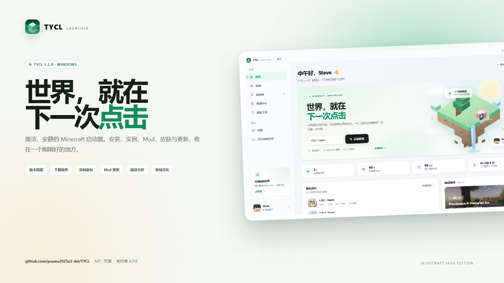

# TYCL 宣传素材

## 一句话介绍

**TYCL：把启动 Minecraft 变回一件轻松的事。**

简洁、安静的 Windows Minecraft Java 版启动器。安装、实例、Mod、皮肤、更新与诊断，收在一个刚刚好的地方。

- GitHub：https://github.com/youwu2025a3-del/TYCL
- 下载：https://github.com/youwu2025a3-del/TYCL/releases/latest
- 更新页：https://tycl-updates-a3y8.youwu2025a3.workers.dev/
- 许可证：MIT
- 制作者：A3Y8

## 核心卖点

- **干净的白 / 暗色界面**：没有广告，没有资讯流，只有游戏。
- **版本隔离**：每个实例独立 mods、存档、资源包和日志。
- **下载可靠**：队列、暂停、断点续传、失败重试、下载源测速。
- **实例管理**：备份、导入、导出、恢复、独立 Java / 内存、一键修复。
- **Mod 管理**：启用 / 禁用、删除、更新检查、重复与冲突提示。
- **整合包**：Modrinth 一键安装，支持在现有实例上更新。
- **崩溃诊断**：自动读取日志与 crash-report，给出可执行的修复建议。
- **新闻汉化**：官方新闻应用内查看，一键翻译成中文。
- **更新不折腾**：只替换 app.asar 的增量更新，稳定版 / 测试版通道。

## 社交平台文案

### QQ 群 / 贴吧短版

> 做了一个 Minecraft 启动器，叫 TYCL。
>
> 白色界面，干净、安静，没有广告。支持正版登录、版本隔离、Mod / 整合包下载、实例备份、下载续传和崩溃诊断。
>
> 开源免费：https://github.com/youwu2025a3-del/TYCL
> 下载：https://github.com/youwu2025a3-del/TYCL/releases/latest
>
> 不隶属于 Mojang 或 Microsoft。

### B 站动态版

> 最近在做一个小项目：TYCL，一个尽量不打扰人的 Minecraft 启动器。
>
> 它没有资讯流，也没有广告。想做的是：打开、选版本、点启动，然后进入世界。
>
> 1.2.0 加了实例备份、Mod 更新检查、下载暂停续传、崩溃诊断和稳定版 / 测试版更新通道。
>
> 源码和安装器都在 GitHub，MIT 协议：
> https://github.com/youwu2025a3-del/TYCL
>
> 如果它让你的启动流程少了一点折腾，欢迎点个 Star。

### 小红书 / 朋友圈版

> 给我的世界做了一件小事：一个干净的 Minecraft 启动器。
>
> 白色、安静、没有广告。
> 能装游戏、装 Mod、备份存档，也能在崩溃时告诉我哪里出了问题。
>
> 开源在 GitHub：TYCL
> Minecraft，慢慢来。

### X / Twitter

> TYCL 1.2.0 — a quiet, minimal Minecraft launcher for Windows.
>
> Instance isolation, resumable downloads, backups, Mod updates, crash diagnostics, and incremental updates.
>
> Open source, MIT.
> https://github.com/youwu2025a3-del/TYCL

## 配图建议

- `promo/TYCL-banner.png`：16:9，1600×900，适合 B 站封面、群公告、README 顶部。
- `screenshots/home.png`：主页截图。
- `screenshots/skins.png`：皮肤工坊。
- `screenshots/news.png`：新闻中心。
- `screenshots/site.png`：下载页。

## 发布检查

- [ ] GitHub Release 已上传安装器
- [ ] README 顶部有下载入口
- [ ] 更新页可访问
- [ ] 安装器未签名时，提醒用户 SmartScreen 选择「仍要运行」
- [ ] 说明 TYCL 不隶属于 Mojang / Microsoft

## 不要写进宣传的内容

- 隐藏彩蛋的触发方式
- 用户数据目录、日志路径等内部细节
- 未验证的性能数字
