# TYCL

> 简洁、安静、刚刚好的 Minecraft 启动器。

[](https://github.com/youwu2025a3-del/TYCL/releases/latest)
[](LICENSE)
[](https://github.com/youwu2025a3-del/TYCL/releases/latest)

**[下载最新版](https://github.com/youwu2025a3-del/TYCL/releases/latest)** · [宣传素材](PROMO.md) · [签名说明](SIGNING.md) · [打包说明](PACKAGING.md)

TYCL 是一个面向 Windows 的 Minecraft Java 版桌面启动器。它以干净的白色界面为基底，把游戏安装、实例管理、Mod / 整合包下载、正版登录与皮肤预览收拢在一个地方。界面基于 Electron 构建，游戏启动核心使用开源库 `minecraft-launcher-core`，资源来自 Modrinth。

**制作者：A3Y8** · **BUG 反馈：tianyi76@yeah.net**


## v1.2.0 新内容

- **实例管理**：备份、导出、导入、恢复、一键修复，以及独立 Java / 内存设置。
- **Mods 管理**：启用/禁用、删除、更新检查、重复与冲突提示。
- **下载可靠性**：暂停/继续、断点续传、失败文件重试、下载源测速。
- **存档与截图**：集中查看，单个存档可独立备份。
- **整合包更新**：在现有实例上同步新版文件，不必重装。
- **更新通道**：稳定版 / 测试版。

## v1.1.7 新内容

- **标题栏图标修复**：增大左上角图标点击区域，并阻止双击误触窗口最大化。

## v1.1.6 新内容

- **皮肤视角修复**：3D 底座与人物同步旋转，不再出现人物“站漂”。
- **新闻详情与汉化**：新闻可在应用内查看简介，翻译按钮更醒目；Mod / 整合包汉化按钮也更大。
- **启动诊断与崩溃分析**：实例菜单可诊断 Java、版本文件和 Mod；异常退出时自动分析日志与 crash-report。
- **下载队列**：顶部栏新增队列入口和红点数量，显示安装、Mod、整合包进度与速度。
- **更新内容展示**：更新后首次进入自动打开本次版本内容。
- **版本隔离**：每个实例默认拥有独立 mods、存档、资源包和日志。

## v1.1.5 新内容

- **Windows 安装器**：安装到用户目录，创建开始菜单、桌面快捷方式和卸载入口。
- **启动自动检查更新**：每次打开 TYCL 都会在后台检查，发现新版本直接弹窗，可一键下载并安装。
- **更新页面重做**：Cloudflare 更新首页加入安装器下载、版本信息和更新说明。

## v1.1.4 新内容

- **Mod / 整合包详情汉化**：详情页新增「汉化」按钮，点击翻译标题和介绍，再点「原文」恢复。
- **Minecraft 术语修正**：对 Fabric、Fabric Loader、原版、生物群系、Sodium、Iris 等术语做后处理。
- **翻译失败保护**：翻译服务不可用时保留原文并提示，不会影响安装和下载。
- **更新重启修复**：更新后首次启动跳过动画并清理渲染缓存，避免卡在启动页；主窗口增加强制显示兜底。

## v1.1.3 新内容

- **修复代理环境下的更新检查**：更新清单和更新包下载改用 Electron 网络栈，自动跟随系统代理，不再超时。
- **更新源保持固定**：继续使用内置的 Cloudflare 更新地址，后续版本无需修改设置。

## v1.1.2 新内容

- **内置更新源**：默认指向 TYCL 的 Cloudflare 更新地址，安装后自动检查新版本，无需手动填写。
- **保留自定义能力**：设置页仍可替换为自建服务器或清空更新源。
- **后台检查更安静**：启动后的自动检查不会打断当前操作。

## v1.1.1 新内容

- **Minecraft 官方新闻中心**：新增新闻页，可浏览、分类筛选和搜索 Minecraft 官方发布的全部消息。
- **设置页排版修复**：改为双栏独立布局，移除外观卡片下方多余的空白区域。
- **顶部更新入口**：移除侧栏重复的「更新公告」，只保留右上角喇叭入口。
- **动效优化**：重新调整页面进入、卡片悬停、新闻加载与按钮反馈，并适配系统「减少动态效果」设置。

## v1.1.0 新内容

- **Microsoft 正版登录**：支持正版服务器验证、官方皮肤与披风。
- **任意版本下载**：下载弹窗现在可以直接选择正式版、快照与旧版本，不再只能安装最新版。
- **TY 启动动画**：启动时展示 TYCL 专属的 TY 字符动画。
- **应用内更新**：支持检查更新、导入本地更新包并在后台替换应用资源，不需要重新下载整个启动器。
- **更新公告与反馈**：新增更新公告、制作者信息与 BUG 反馈入口。
- 修复旧版本 natives 架构混入 classpath 导致启动失败的问题。

## 功能

- **简洁的白色界面**：浅色 / 深色 / 跟随系统三种主题，5 种强调色，设置实时保存。
- **Minecraft 官方新闻**：直接读取 Minecraft 官方启动器内容接口，按 Java 版 / 基岩版 / 地牢 / 传奇筛选，并支持标题搜索。
- **游戏下载与实例管理**：支持 Vanilla、Fabric、Forge、Quilt 加载器；可安装任意正式版 / 快照 / 旧版本；每个实例拥有独立存档、Mod 和配置。
- **Microsoft 正版登录**：使用 Microsoft 官方登录页完成 OAuth 授权，自动完成 Xbox Live 与 Minecraft 验证，令牌只保存在本机。
- **离线账户**：不登录也可以玩单人与局域网游戏。
- **Modrinth 资源中心**：搜索、筛选并安装 Mod 和整合包；自动选择兼容版本，补齐必需前置 Mod。
- **皮肤工坊**：本地 3D 皮肤预览、经典 / 纤细模型切换、PNG 拖入导入、皮肤库管理。
- **自动更新**：应用内检查更新、下载或导入更新包，退出后自动替换并重启。
- **本地化与安全**：渲染进程启用上下文隔离与 CSP，文件操作和网络操作集中在主进程。

## 截图

| 皮肤工坊 | 资源中心 |
| --- | --- |
| 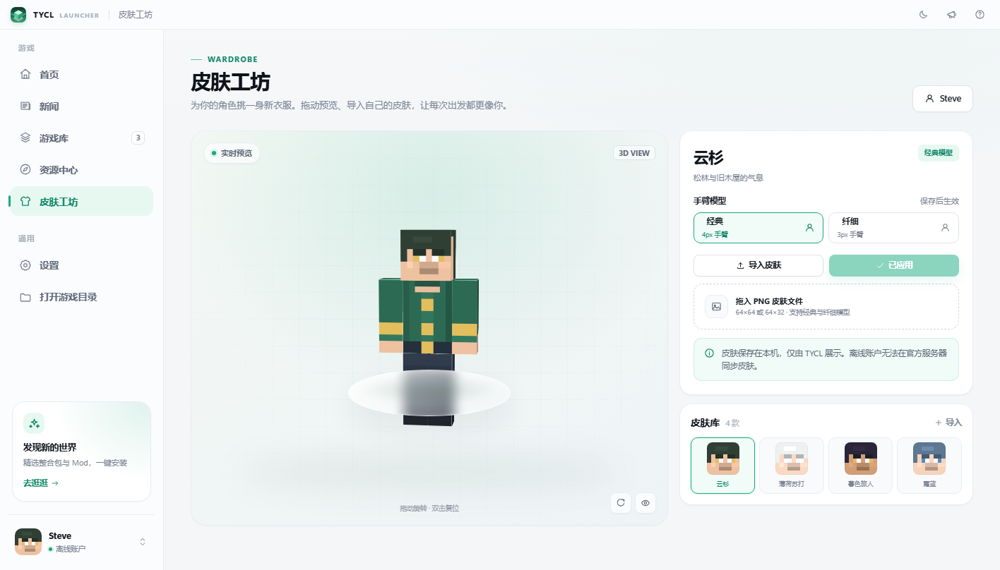 | 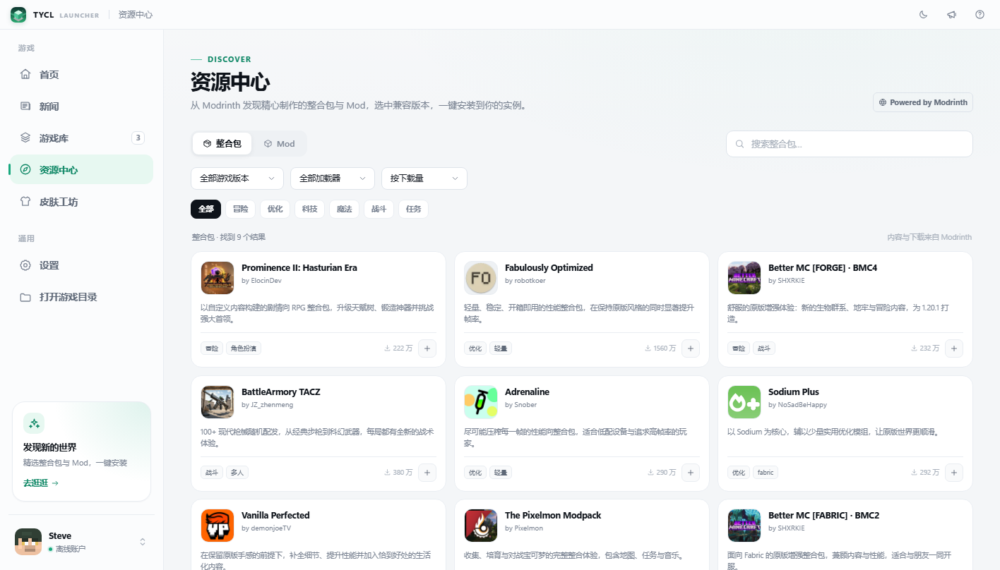 |

| 新闻中心 | 设置与反馈 |
| --- | --- |
| 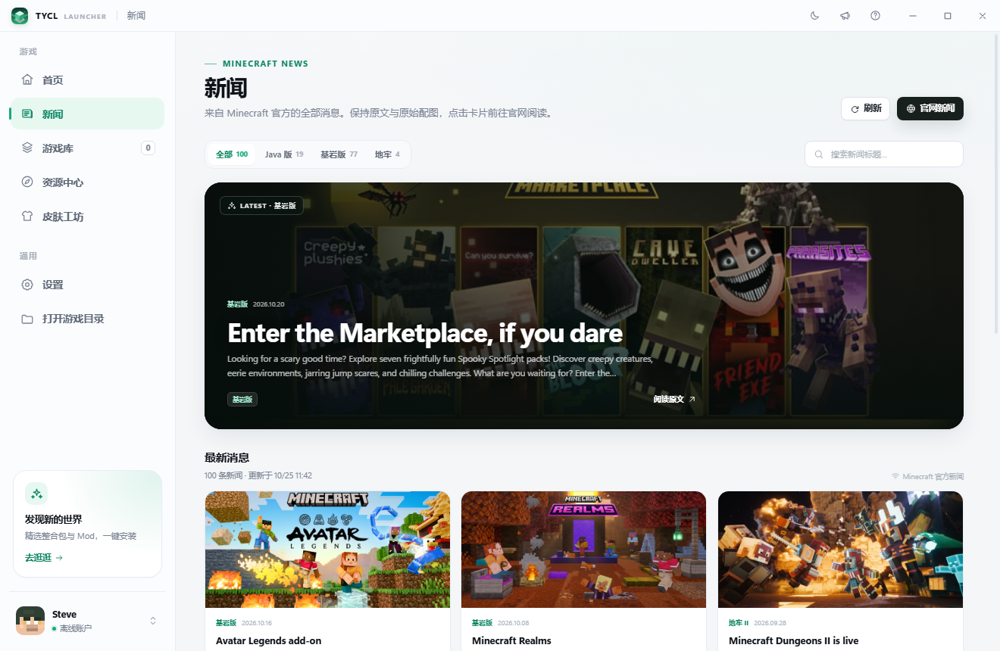 | 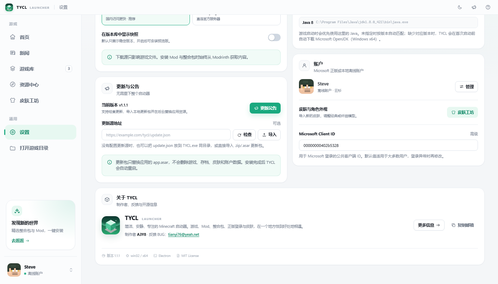 |

| 深色主题 | 设置 |
| --- | --- |
| 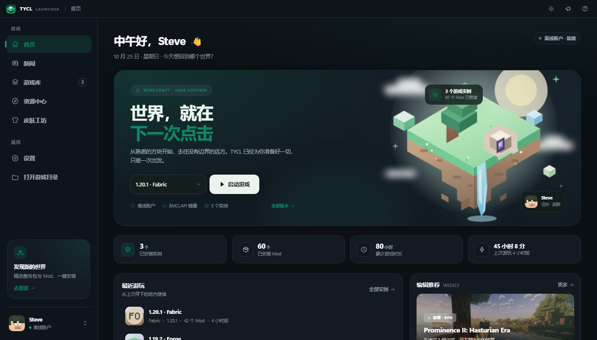 | 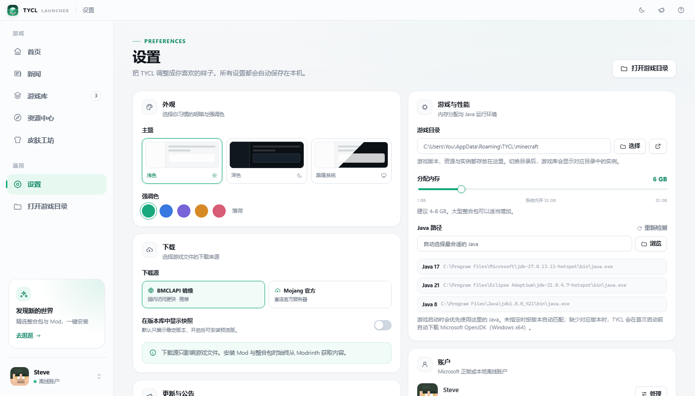 |

| 任意版本安装 | 更新公告 |
| --- | --- |
| 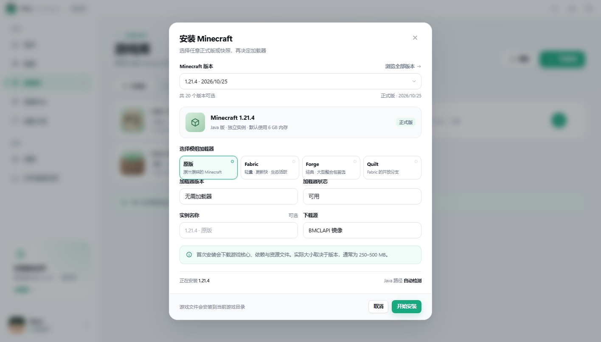 | 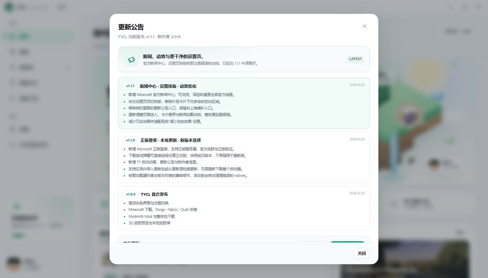 |

| Microsoft 登录 | TY 启动动画 |
| --- | --- |
|  | 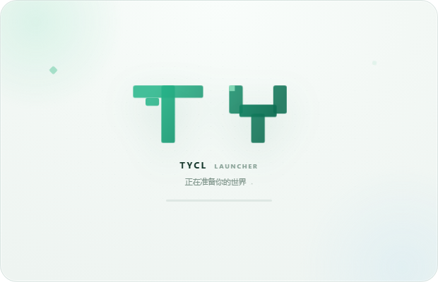 |

| 更新下载页 | 自动更新提示 |
| --- | --- |
| 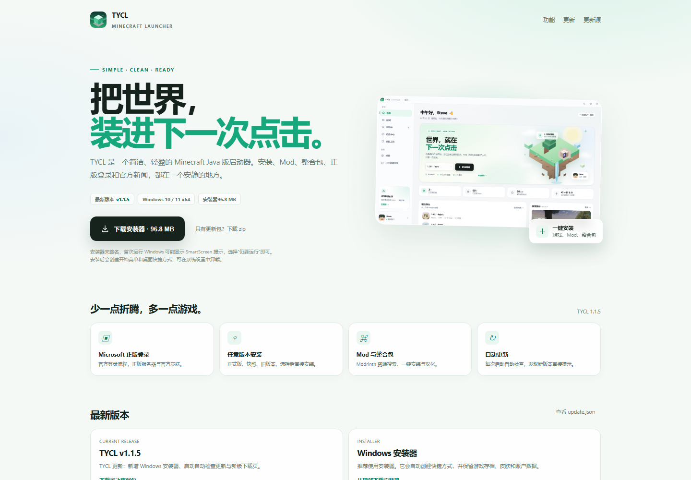 | 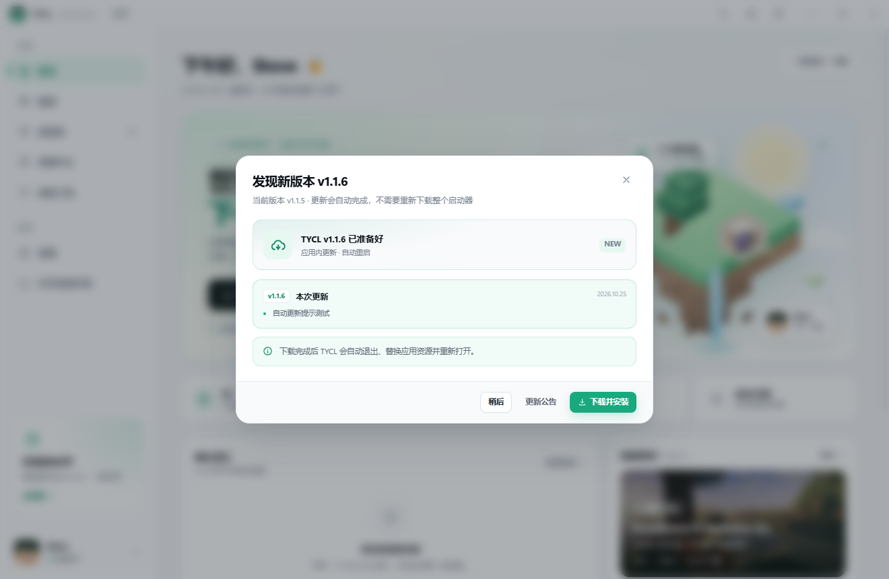 |

## 运行

### 环境要求

- Windows 10 / 11 x64（当前主要支持平台）
- Node.js 20 或更高版本
- npm 10+
- 建议安装 Java 17 或 Java 21；缺少时启动器会在 Windows x64 上自动下载

### 安装与启动

```bash
cd tycl
npm install
npm start
```

也可以直接双击 `启动TYCL.bat`。

> 项目内的 `.npmrc` 已配置 Electron 国内镜像 `npmmirror.com`，在中国大陆安装依赖会快一些。

### 打包 Windows 便携版

```bash
npm run package:win
```

构建产物位于 `dist/TYCL-win32-x64/`，双击 `TYCL.exe` 即可运行，无需安装 Node.js。便携版未做代码签名，首次运行时 Windows 可能显示 SmartScreen 提示，选择“仍要运行”即可。

### 打包 Windows 安装器

安装器使用开源的 [Inno Setup 6](https://jrsoftware.org/isinfo.php) 构建：

```bash
winget install JRSoftware.InnoSetup
npm run package:win
npm run installer:pack
```

生成 `dist/TYCL-Setup-<version>.exe`。安装器按当前用户安装到 `%LOCALAPPDATA%\Programs\TYCL`，创建开始菜单、桌面快捷方式和卸载入口，无需管理员权限。

> 安装器未做代码签名，首次运行 Windows SmartScreen 可能提示未知发布者，选择“更多信息 → 仍要运行”即可。建议右键安装器，选择「以管理员身份运行」。

## 使用说明

1. **下载游戏**：首页「下载游戏」会打开安装窗口。窗口顶部的下拉框可以选择任意正式版、快照或旧版本，再选择加载器并安装。
2. **正版登录**：点击左侧账户卡片，选择「使用 Microsoft 账户登录」。TYCL 会打开 Microsoft 官方登录窗口；登录成功后自动完成 Xbox Live / Minecraft 验证。密码不会经过 TYCL。
3. **启动游戏**：安装完成后回到首页或游戏库，选择实例后点击启动。首次启动若缺少 Java，会显示 Java 下载进度。
4. **安装 Mod / 整合包**：进入「资源中心」，搜索并打开详情，选择目标实例与版本后安装。
5. **更换皮肤**：在「皮肤工坊」选择内置皮肤或导入 64×64 / 64×32 的 PNG，调整模型后点击「应用皮肤」。
6. **检查更新**：每次启动会自动检查更新，发现新版本会直接弹窗；也可点击右上角喇叭图标手动检查、查看公告、导入本地更新包，或联系作者反馈 BUG。

## 正版登录说明

- 登录使用 Microsoft 公共客户端 ID `00000000402b5328`，认证在 Electron 内置浏览器中完成，令牌保存在本机数据目录，不会上传到 TYCL 的任何服务器。
- 登录依赖 `login.live.com`、`xboxlive.com` 和 `api.minecraftservices.com` 的网络访问；如果登录异常，请确认网络、双重验证或 Xbox 账户状态。
- 需要自定义 Azure 应用时，可以在「设置 → 账户」填写自己的 Microsoft Client ID。重定向 URI 需为 `https://login.live.com/oauth20_desktop.srf`。
- 只有拥有 Minecraft Java 版授权或有效 Game Pass 的账户才能完成验证。部分未成年 / 家庭账户可能需要先在 Xbox 页面完成设置。

## 更新与本地热更新

TYCL 支持只替换 `resources/app.asar` 的应用内更新，不需要重新下载整个便携版。

### 方式一：导入本地更新包

1. 获取 `TYCL-update-x.y.z.zip`（内部包含 `app.asar` 与可选 `update.json`）或直接准备新的 `app.asar`。
2. 打开「更新公告 → 导入更新包」，选择文件并确认安装。
3. TYCL 会退出，后台脚本替换 `app.asar`，然后自动重新启动。
4. 旧文件会备份为 `app.asar.bak`。

### 方式二：配置更新源

在「设置 → 更新与公告」填写 `update.json` 的 HTTP(S) 地址，或把 `update.json` 放到 `TYCL.exe` 同级目录。更新公告里点击「检查更新」即可下载并安装。

`update.json` 示例（也可以参考仓库根目录的 `update.example.json`）：

```json
{
  "version": "1.1.2",
  "notes": "本次更新内容…",
  "downloadUrl": "https://example.com/TYCL-update-1.1.2.zip",
  "sha256": "更新包 zip 的 SHA-256",
  "publishedAt": "2026-10-25T00:00:00.000Z",
  "mandatory": false
}
```

### 制作更新包

```bash
npm run package:win
npm run update:pack
```

会生成 `dist/TYCL-update-<version>.zip` 和带校验值的 `dist/update.json`。上传 zip 并把 `downloadUrl` 填成公网地址即可。

### 方式三：Cloudflare Pages（无公网 IP 也能用）

更新包很小，可以直接把 `update.json` 和更新 zip 托管到 Cloudflare Pages：

```bash
npm run update:pack
npm run pages:pack
```

会生成 `dist/pages-upload/`，里面的 `update.json` 已经包含版本、zip 地址和 SHA-256。把这个目录里的所有文件上传到同一个 Pages 项目即可。

- Pages 生产地址（例如 `https://tycl-updates-a3y8.youwu2025a3.workers.dev/update.json`）在后续部署中**不会变化**。
- 每次更新只需要重新生成 zip、重新上传文件，不需要修改 TYCL 里的更新源地址。
- 下载页会同时发布 Windows 安装器；安装器约 97 MB，会被拆成多个 20 MB 分卷，避免超过 Cloudflare Pages 单文件 25 MiB 限制。
- 如果 Cloudflare 拒绝上传 100 MB 的 zip，请解压后把 `pages-upload` 里的所有文件拖进上传框，分卷文件不会被拆分错误。
- `pages:pack` 默认使用 `https://tycl-updates-a3y8.youwu2025a3.workers.dev`；项目名不同可执行：

```bash
PAGES_BASE_URL=https://your-project.pages.dev npm run pages:pack
```

> `pages.dev` 在部分网络环境可能访问较慢；如果用户主要在中国大陆，建议测试后再决定是否使用，或换用可访问的对象存储 / 自定义域名。

> 自动更新替换的是应用代码包。如果未来升级了 Electron 运行时或原生依赖，仍需重新分发完整便携版。

## 数据目录

默认存放于：

```
%APPDATA%\TYCL
```

其中 `minecraft/` 是默认游戏目录，实例元数据位于游戏目录下的 `tycl-instances/`，下载的 Java 运行时位于 `runtimes/`，Microsoft 账户令牌保存在本机 `data/accounts.json`。

若需要便携化或测试，可设置环境变量：

```powershell
$env:TYCL_DATA_DIR = "D:\TYCL-Data"
npm start
```

## 项目结构

```
tycl/
├─ electron/              # Electron 主进程
│  ├─ main.js             # 窗口、启动动画、登录窗口、IPC
│  ├─ preload.js          # 安全的渲染进程 API
│  ├─ auth.js             # Microsoft OAuth / Xbox / Minecraft 认证
│  ├─ updater.js          # 检查更新、导入更新包、后台替换与重启
│  ├─ installer.js        # 游戏 / 加载器安装
│  ├─ launcher.js         # MCLC 启动、日志、Java 选择
│  ├─ modrinth.js         # Modrinth 搜索 / Mod / 整合包
│  ├─ versions.js         # 版本清单与加载器元数据
│  ├─ java.js             # Java 检测与自动下载
│  ├─ skin.js             # 皮肤存储
│  ├─ tasks.js            # 可取消后台任务
│  └─ ...
├─ src/                   # 渲染进程（原生 ES Modules，无构建步骤）
│  ├─ index.html
│  ├─ splash.html         # TY 启动动画
│  ├─ css/
│  ├─ js/
│  │  ├─ pages/           # 首页 / 游戏库 / 资源中心 / 皮肤 / 设置
│  │  ├─ flows.js         # 安装、账户、更新公告等弹窗
│  │  ├─ skin3d.js        # CSS 3D 皮肤预览
│  │  └─ mock.js          # 浏览器演示数据
│  └─ assets/
├─ scripts/
│  ├─ check-syntax.js
│  ├─ package.js
│  └─ make-update.js
├─ 启动TYCL.bat
└─ package.json
```

## 开发

```bash
npm run lint          # 校验主进程与渲染进程 JS 语法
npm run dev           # 打开开发者工具
npm run package:win   # 构建便携版
npm run installer:pack # 构建 Windows 安装器
npm run update:pack   # 生成应用更新包
npm run pages:pack    # 生成 Cloudflare Pages 上传目录
```

渲染层不依赖打包器。直接在浏览器打开 `src/index.html` 时会以演示数据运行（用于 UI 预览）；在 Electron 中则会走真实 IPC。

## 已知限制

- 自动更新只替换 `app.asar`，不包含 Electron 大版本升级。
- 自动下载 Java 仅支持 Windows x64 的 Java 17 / 21；其他情况请在设置中选择 `java.exe`。
- 新闻中心读取 Minecraft 官方启动器内容接口，正文保持官方英文原文，阅读全文会在系统浏览器打开 minecraft.net。
- 资源下载仅接入 **Modrinth**，未接入 CurseForge；暂不支持 NeoForge。
- 皮肤只保存在本地启动器中。Microsoft 正版账户在游戏中会使用官方皮肤。
- Forge 首次安装会运行官方安装器，需要可用的 Java 和网络连接。
- 本项目与 Mojang Studios、Microsoft 无关联。Minecraft 是 Mojang Studios 的商标。

## 反馈

- 制作者：A3Y8
- BUG 反馈 / 建议：**tianyi76@yeah.net**
- 反馈时请附上 TYCL 版本、Windows 版本、Minecraft 版本与启动日志，能更快定位问题。

## 开源与致谢

TYCL 的实现离不开这些开源项目与服务：

- [Electron](https://www.electronjs.org/) — MIT
- [minecraft-launcher-core](https://github.com/Pierce01/MinecraftLauncher-core) — MIT
- [adm-zip](https://github.com/cthackers/adm-zip) — MIT
- [undici](https://undici.nodejs.org/) — MIT
- [Modrinth API](https://docs.modrinth.com/) — 资源检索与下载
- [Minecraft Launcher Content](https://launchercontent.mojang.com/v2/news.json) — 官方新闻与配图
- [Fabric](https://fabricmc.net/) / [Quilt](https://quiltmc.org/) — 加载器元数据
- 截图中的整合包封面、Mod 图标来自 Modrinth 上对应项目，版权归原作者所有。

## License

MIT
